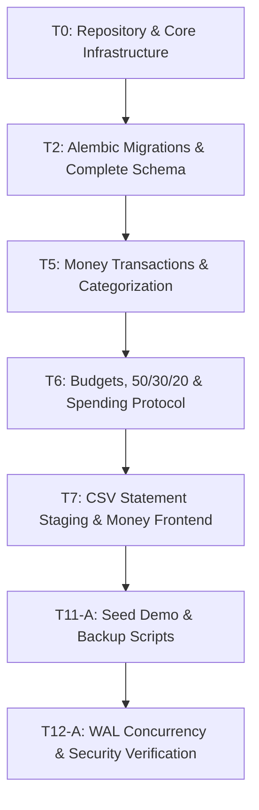

# FinWise AI — Aman Development Handbook

**Document ID:** DOC-HB-AMAN-004  
**Developer:** AMAN  
**Role:** Core Platform Infrastructure, Money Engine & Persistence Lead  
**Contract Version Target:** 1.0.0 (`docs/SHARED_TECHNICAL_CONTRACT.md`)  
**Status:** Approved for Immediate Autonomous Execution  

---

## 1. Project Overview & Relevant Architecture

FinWise AI is a local, privacy-first personal finance and smart purchasing advisory web app designed for final-year engineering capstone evaluation.

As the platform and money engine lead, you own the bedrock of the system:
1. **Core Infrastructure:** Configuration, database engine with SQLite WAL concurrency pragmas, deterministic clock, cryptography (Argon2id & Fernet), and HTTP middleware.
2. **Persistence & Migrations:** Complete Alembic migration suite establishing all database tables across the application.
3. **Money Subsystem:** Transaction management, duplicate hash detection, 50/30/20 budget calculations, savings goal progress tracking, HDFC/SBI/ICICI CSV statement parsing, staging area, and CSV export protection.
4. **Data Operations:** Demonstration seed generator (`scripts/seed_demo.py`) and backup/restore scripts.
5. **Money Frontend:** Dedicated UI components for transactions, budgets, goals, and import workflows located inside `frontend/src/features/money/`.

You will develop, test, and verify your entire subsystem in complete isolation without waiting for or depending on Vivek's auth or decision engine code.

---

## 2. Aman's Responsibilities & Ownership Boundaries

### What You Own:
- `backend/app/core/config.py`, `db.py`, `clock.py`, `crypto.py`, `middleware.py`, `logging.py`, `health.py`
- `backend/app/modules/money/**` (All routes, services, schemas, and models)
- `backend/app/modules/invest/**` (Optional Stretch)
- `backend/alembic/**` (Sole owner of migration generation and execution)
- `backend/tests/test_core_*.py`, `backend/tests/test_money_*.py`
- `frontend/src/features/money/**` (React components for Money)
- `scripts/**` (`seed_demo.py`, `export_data.py`, `restore_data.py`)
- `backend/pyproject.toml` (Base dependency manifest)

---

## 3. Requirements Assigned to Aman

All requirements are traced directly to PRD Revision 6:

| Req ID | Title | Priority | Target File / Service |
|---|---|---|---|
| **MONEY-001** | Manual Transaction Logging | Core | `modules/money/services/transaction_service.py` |
| **MONEY-002** | Transaction Categorization & Hashing | Core | `modules/money/services/category_service.py` |
| **MONEY-003** | CSV Statement Upload & 30-min Staging | Core | `modules/money/services/import_service.py` |
| **MONEY-004** | Staged Row Approval & Atomic Commit | Core | `modules/money/services/import_service.py` |
| **MONEY-005** | Monthly Fixed & Flexible Budgets | Core | `modules/money/services/budget_service.py` |
| **MONEY-006** | 50/30/20 Rule Computation Engine | Core | `modules/money/services/budget_service.py` |
| **MONEY-007** | Budget Rollover & Velocity Calculation | Core | `modules/money/services/budget_service.py` |
| **MONEY-008** | Discretionary Spending Money Contract | Core | `modules/money/services/spending_service.py` |
| **MONEY-009** | Savings Goals Creation & Target Tracking | Core | `modules/money/services/goal_service.py` |
| **MONEY-010** | Goal Contribution Locking | Core | `modules/money/services/goal_service.py` |
| **MONEY-011** | Emergency Buffer Reserve Calculation | Core | `modules/money/services/spending_service.py` |
| **MONEY-012** | Search, Sort & Multi-Filter Transactions | Core | `modules/money/routers/transactions.py` |
| **MONEY-013** | Soft Deletion & Audit Trail | Core | `modules/money/models/transaction.py` |
| **MONEY-014** | Category Breakdown & Monthly Spend Trend | Core | `frontend/src/features/money/components/SpendCharts.tsx` |
| **MONEY-014b**| Income vs Expense Comparative Visuals | Plus | `frontend/src/features/money/components/IncomeExpenseBar.tsx` |
| **MONEY-015** | CSV Export with Formula Injection Guard | Plus | `modules/money/services/export_service.py` |
| **SEC-01..07** | Cryptography, SQLite WAL, Argon2id, Fernet | Core | `core/crypto.py`, `core/db.py` |
| **NFR-01..05** | Local Performance & Deterministic Time | Core | `core/clock.py`, `core/middleware.py` |

---

## 4. Explicit Exclusions: What Aman Must NOT Do

1. **Do NOT write Auth/JWT/User management logic:** Vivek owns `backend/app/core/auth/`. You must use the local mock dependency `get_current_user_override` (see §12).
2. **Do NOT write Pricing or Decision Engine logic:** Vivek owns `modules/pricing/` and `modules/decision/`.
3. **Do NOT write the Application Shell or Header:** Vivek owns `frontend/src/features/shell/` and `frontend/src/app/`.
4. **Do NOT modify Vivek's frontend components:** Never edit `frontend/src/features/auth/`, `pricing/`, `decision/`, or `overview/`.
5. **Do NOT create custom Alembic branching:** All migrations are strictly linear.

---

## 5. Source Documentation to Read First

Before writing any code, thoroughly review:
1. `docs/PROJECT_AUDIT_REPORT.md` (System purpose, verified stack, resolved ambiguities).
2. `docs/ARCHITECTURE_AND_MODULE_OWNERSHIP.md` (Module boundaries and file rules).
3. `docs/SHARED_TECHNICAL_CONTRACT.md` (§2 Auth override, §3 Contract Protocol, §5 Database Schemas).
4. `FinWise AI — Product Requirements Document.md` (§4.2 Money Requirements, §7 Database Schemas).

---

## 6. Files Aman May Create or Modify

```
backend/
├── pyproject.toml
├── alembic.ini
├── alembic/
│   ├── env.py
│   ├── script.py.mako
│   └── versions/
│       └── 001_initial_schema.py
├── app/
│   ├── main.py (Scaffolding only)
│   ├── core/
│   │   ├── config.py
│   │   ├── db.py
│   │   ├── clock.py
│   │   ├── crypto.py
│   │   ├── middleware.py
│   │   ├── logging.py
│   │   ├── health.py
│   │   └── contracts.py (Implements MoneyModuleProtocol)
│   └── modules/
│       ├── money/
│       │   ├── __init__.py
│       │   ├── models/
│       │   ├── schemas/
│       │   ├── services/
│       │   └── routers/
│       └── invest/ (Stretch)
├── tests/
│   ├── conftest.py
│   ├── test_core_*.py
│   └── test_money_*.py
frontend/
└── src/
    └── features/
        └── money/
            ├── components/
            ├── hooks/
            └── pages/
scripts/
├── seed_demo.py
├── export_data.py
└── restore_data.py
```

---

## 7. Files Aman Must NOT Modify

- `backend/app/core/auth/**` (Vivek)
- `backend/app/core/notifications/**` (Vivek)
- `backend/app/core/settings/**` (Vivek)
- `backend/app/core/overview.py` (Vivek)
- `backend/app/modules/pricing/**` (Vivek)
- `backend/app/modules/decision/**` (Vivek)
- `frontend/src/features/auth/**` (Vivek)
- `frontend/src/features/shell/**` (Vivek)
- `frontend/src/features/pricing/**` (Vivek)
- `frontend/src/features/decision/**` (Vivek)
- `frontend/src/features/overview/**` (Vivek)
- `frontend/src/shared/ui/**` (Vivek)

---

## 8. Implementation Sequence & Task Schedule



---

## 9. Detailed Technical Instructions by Task

### Task T0: Repository Initialization & Core Infrastructure
- **Objective:** Establish the Python 3.12 project structure, install dependencies via `uv`, configure linting/type-checking, and create core utilities.
- **Commands:**
  ```powershell
  uv init --app backend
  cd backend
  uv add fastapi uvicorn pydantic pydantic-settings sqlalchemy alembic argon2-cffi cryptography pytest pytest-asyncio httpx
  uv add --dev ruff mypy
  ```
- **Key Deliverables:**
  - `core/config.py`: Loads `.env` via `pydantic-settings.BaseSettings`.
  - `core/db.py`: Configures `create_engine("sqlite:///./finwise.db")` with WAL pragmas:
    ```python
    from sqlalchemy import event, create_engine
    @event.listens_for(engine, "connect")
    def set_sqlite_pragma(dbapi_connection, connection_record):
        cursor = dbapi_connection.cursor()
        cursor.execute("PRAGMA journal_mode=WAL;")
        cursor.execute("PRAGMA synchronous=NORMAL;")
        cursor.execute("PRAGMA foreign_keys=ON;")
        cursor.execute("PRAGMA busy_timeout=5000;")
        cursor.close()
    ```
  - `core/clock.py`: Provides `SystemClock` with frozen-date capability for testing.
  - `core/crypto.py`: Argon2id password hash/verify and Fernet token encrypter/decrypter.
  - `core/health.py`: Liveness endpoint `/health`.

### Task T2: Alembic Setup & Comprehensive Database Schema
- **Objective:** Create the initial migration establishing all tables specified in PRD §7 so both developers have a complete schema.
- **Key Tables to Include:**
  - `users`, `user_settings`, `notifications`, `audit_log` (Core/Auth)
  - `accounts`, `categories`, `transactions`, `budgets`, `savings_goals`, `imports`, `import_staged_rows` (Money)
  - `products`, `price_observations`, `decisions`, `cooling_off_periods` (Pricing/Decision)
- **Execution:**
  ```powershell
  alembic init alembic
  # Edit env.py to link Base.metadata
  alembic revision -m "001_initial_schema"
  alembic upgrade head
  ```

### Task T5: Money Data Layer & Transactions API
- **Objective:** Deliver CRUD endpoints for accounts, categories, and transactions with duplicate hashing.
- **Duplicate Hash Algorithm:**
  ```python
  import hashlib
  def compute_transaction_hash(account_id: int, date: str, amount: float, desc: str) -> str:
      payload = f"{account_id}|{date}|{amount:.2f}|{desc.strip().lower()}"
      return hashlib.sha256(payload.encode()).hexdigest()
  ```
- **Endpoints:** `GET /api/v1/transactions`, `POST /api/v1/transactions`, `PUT /api/v1/transactions/{id}`, `DELETE /api/v1/transactions/{id}` (Soft delete).

### Task T6: Budgets, 50/30/20 Engine & Spending Contract Protocol
- **Objective:** Implement budget allocation, monthly rollover, savings goals, and the inter-module contract `MoneyService.get_spending_money()`.
- **Mathematical Formula for Discretionary Spending ($S$):**
  $$S = \text{Available Balance} - (\text{Fixed Costs Reserved} + \text{Savings Goals Reserved} + \text{Emergency Buffer})$$
- **Contract Fulfillment:** Implement `MoneyModuleProtocol` inside `backend/app/modules/money/services/spending_service.py`.

### Task T7: Bank CSV Import Pipeline & Money UI
- **Objective:** Build parsers for HDFC, SBI, ICICI CSV statements with 30-minute staging expiration and CSV formula injection guard (`MONEY-015`).
- **Formula Injection Guard:** If any field in a CSV export starts with `=`, `+`, `-`, or `@`, prepend a single quote (`'`).
- **Frontend Delivery:** Build `frontend/src/features/money/` components (TransactionTable, CategorySelect, ImportModal, BudgetGauge).

### Task T11-A: Seed Script & Backup CLI
- **Objective:** Implement `scripts/seed_demo.py` generating 90 days of synthetic transactions and budgets for the demo account (`demo@finwise.local`).

---

## 10. Exact Interfaces & Contracts to Follow

- You must strictly implement `MoneyModuleProtocol` defined in `docs/SHARED_TECHNICAL_CONTRACT.md` §3.
- All endpoints must return the standardized error envelope (`docs/SHARED_TECHNICAL_CONTRACT.md` §4.1).
- All Money routes must mount under `/api/v1/` prefix.

---

## 11. Local Setup & Independent Execution Instructions

```powershell
# 1. Clone & checkout Aman branch
git checkout -b feature/aman-platform-money

# 2. Setup backend
cd backend
uv sync
cp .env.example .env

# 3. Apply database migration
uv run alembic upgrade head

# 4. Run tests
uv run pytest tests/ -v

# 5. Start dev server
uv run uvicorn app.main:app --reload --port 8000
```

---

## 12. Mocking Instructions for Vivek's Auth Module

To test your API endpoints before Vivek finishes authentication:
```python
# backend/tests/conftest.py
import pytest
from app.core.auth.dependencies import get_current_user
from app.core.contracts import AuthenticatedUser

@pytest.fixture(autouse=True)
def override_auth_for_tests(app):
    app.dependency_overrides[get_current_user] = lambda: AuthenticatedUser(
        id=1, email="aman.test@local.env", is_demo=False, currency="INR"
    )
```

---

## 13. Required Unit, Integration & Concurrency Tests

You are required to achieve **>85% code coverage** on your owned modules:
1. `test_crypto.py`: Test Argon2id hashing/verification and Fernet encryption/decryption round-trip.
2. `test_transactions.py`: Test CRUD, soft-delete filtering, and duplicate hash collisions.
3. `test_budgets.py`: Test 50/30/20 calculation edge cases (e.g. zero income, negative balance).
4. `test_spending_money.py`: Test `get_spending_money` contract with positive, zero, and deficit cash flows.
5. `test_csv_import.py`: Test HDFC, SBI, ICICI format parsing, 30-min staging expiration, and atomic commit.
6. `test_csv_injection.py`: Test formula escaping on export.
7. `test_wal_concurrency.py`: 10 concurrent threads inserting transactions simultaneously without `sqlite3.OperationalError: database is locked`.

---

## 14. Quality Standards & Definition of Done

A task is marked **DONE** only when:
- [ ] 100% type hints pass `uv run mypy --strict app`.
- [ ] Zero lint violations in `uv run ruff check .`.
- [ ] All unit and integration tests pass cleanly via `uv run pytest`.
- [ ] Database migrations upgrade and downgrade cleanly.
- [ ] No files outside Aman's ownership were modified.

---

## 15. Git Workflow & Isolation Rules

- Work exclusively on `feature/aman-platform-money`.
- Commit with conventional commit messages: `feat(money): ...`, `test(core): ...`.
- Never commit to `main` directly.
- Submit a PR targeting `integration/parallel-development`.
