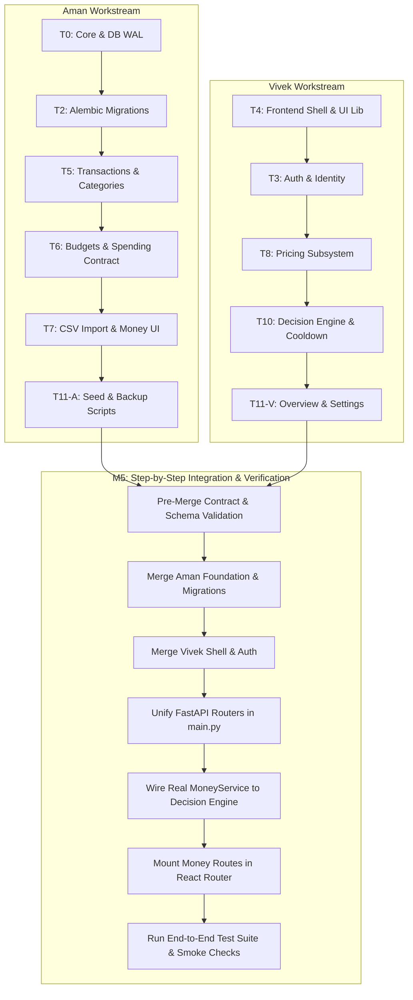

# FinWise AI — Integration & Merge Guide

**Document ID:** DOC-INT-006  
**Version:** 1.0.0  
**Target Milestone:** M5 (Integration) & M6 (Release Readiness)  
**Integration Owner:** Senior Integration Specialist  
**Effective Date:** 20-Oct-2026  

---

## 1. Integration Overview & Architecture Map

This guide provides the deterministic, reproducible procedure for combining the independent contributions of **Aman** (`feature/aman-platform-money`) and **Vivek** (`feature/vivek-shell-decision`) into a unified, release-ready system on `integration/parallel-development` and `main`.



---

## 2. Integration Prerequisites & Pre-Flight Checks

Before initiating the merge sequence, the Integration Owner must verify that both branches meet the following entry criteria:

### Branch Inspection Checklist
1. **Aman Branch (`feature/aman-platform-money`):**
   - [ ] Clean working tree (no uncommitted or untracked scratch files).
   - [ ] All commits follow conventional commit format (`feat:`, `fix:`, `test:`).
   - [ ] Backend tests pass: `uv run pytest tests/test_core_* tests/test_money_*`.
   - [ ] Mypy passes: `uv run mypy --strict app`.
   - [ ] Alembic migration `001_initial_schema.py` executes cleanly on fresh SQLite DB.
   - [ ] Money UI components compile without TypeScript errors.

2. **Vivek Branch (`feature/vivek-shell-decision`):**
   - [ ] Clean working tree.
   - [ ] All commits follow conventional commit format.
   - [ ] Backend tests pass: `uv run pytest tests/test_auth_* tests/test_pricing_* tests/test_decision_*`.
   - [ ] Decision Engine passes with `MockMoneyService`.
   - [ ] Frontend compiles cleanly: `npm run build` in `frontend/`.
   - [ ] Vitest component tests pass: `npm run test:unit`.

---

## 3. Step-by-Step Merge Sequence

All merge actions take place on a dedicated integration branch: `integration/parallel-development`.

### Step 1: Initialize Integration Branch
```powershell
git checkout main
git pull origin main
git checkout -b integration/parallel-development
```

### Step 2: Merge Aman's Foundational Branch First
Aman's branch contains core infrastructure (`config.py`, `db.py`, `crypto.py`) and Alembic migrations. It forms the foundation.
```powershell
git merge --no-ff feature/aman-platform-money -m "merge: incorporate Aman platform and money subsystem"
```
*Expected Conflicts:* None (clean merge into baseline).

### Step 3: Rebase and Merge Vivek's Branch
Vivek's branch introduces Auth, Pricing, Decision Engine, and the Frontend Shell.
```powershell
git checkout feature/vivek-shell-decision
git rebase integration/parallel-development
# If conflicts occur, resolve per §4 below
git checkout integration/parallel-development
git merge --no-ff feature/vivek-shell-decision -m "merge: incorporate Vivek shell, auth, and decision engine"
```

---

## 4. Conflict Resolution Rules

Because module ownership was strictly partitioned in `docs/ARCHITECTURE_AND_MODULE_OWNERSHIP.md`, merge conflicts are mathematically limited to only three centrally controlled files:

### Conflict Point A: `backend/app/main.py`
- *Cause:* Both developers mount their respective FastAPI routers.
- *Resolution Rule:* Accept both router registrations. Ensure the mounting order is preserved:
  ```python
  # Correct unified backend/app/main.py router mounts
  app.include_router(health.router, tags=["Health"])
  app.include_router(auth.router, prefix="/api/v1/auth", tags=["Auth"])
  app.include_router(settings.router, prefix="/api/v1/settings", tags=["Settings"])
  app.include_router(overview.router, prefix="/api/v1/overview", tags=["Overview"])
  app.include_router(money.router, prefix="/api/v1", tags=["Money"])
  app.include_router(pricing.router, prefix="/api/v1/pricing", tags=["Pricing"])
  app.include_router(decision.router, prefix="/api/v1/decisions", tags=["Decision Engine"])
  ```

### Conflict Point B: `frontend/src/app/routes.tsx`
- *Cause:* Aman registers `/money/*` routes; Vivek registers `/auth/*`, `/pricing/*`, `/decisions/*`.
- *Resolution Rule:* Keep Vivek's shell layout and replace Aman's route placeholder with the real `MoneyPage` component:
  ```tsx
  import { MoneyPage } from "@/features/money/pages/MoneyPage";
  // Inside route definitions:
  { path: "/money/*", element: <MoneyPage /> }
  ```

### Conflict Point C: `pyproject.toml` or `package.json`
- *Cause:* Dependency version adjustments.
- *Resolution Rule:* Union of all dependencies. Never downgrade a version requested by either developer.

---

## 5. Wiring Real Implementations (Replacing Mocks)

Once merged, the test doubles used during parallel development must be swapped for real implementations:

### 5.1 Wire Real `MoneyService` into Decision Engine
In `backend/app/modules/decision/services/engine.py`:
```python
# Before (Vivek's Mock):
# from app.modules.decision.services.mock_money import MockMoneyService
# money_service = MockMoneyService()

# After (Real Integration):
from app.modules.money.services.spending_service import RealMoneyService
from app.core.db import get_db

def get_decision_engine(db: Session = Depends(get_db)):
    money_service = RealMoneyService(db=db)
    return DecisionEngine(money_service=money_service)
```

### 5.2 Remove Auth Overrides from Money Routes
Ensure all Money routes in `backend/app/modules/money/routers/` consume the real `get_current_user` dependency from `app.core.auth.dependencies` rather than the mock user fixture.

---

## 6. End-to-End Build & Verification Commands

Execute the complete verification pipeline in this exact sequence:

```powershell
# 1. Reset database to clean state
Remove-Item -Path "finwise.db" -ErrorAction SilentlyContinue

# 2. Execute database migrations
cd backend
uv run alembic upgrade head

# 3. Seed demo dataset (90 days of transactions, budgets, products, decisions)
uv run python ../scripts/seed_demo.py

# 4. Run entire backend test suite
uv run pytest tests/ -v --cov=app

# 5. Compile and test frontend
cd ../frontend
npm install
npm run build
npm run test:unit

# 6. Run full Playwright End-to-End test suite
npx playwright test
```

---

## 7. Manual Smoke-Test Procedures (User Journeys J-1 to J-6)

Verify these 6 critical flows manually via browser at `http://localhost:5173`:

| Journey ID | Title | Test Steps | Expected Result |
|---|---|---|---|
| **J-1** | First-Time Onboarding | Register new user `viva@test.com`, log in, complete initial budget setup (50,000 income, 50/30/20). | Dashboard displays initial health score and spending money gauge. |
| **J-2** | Manual & CSV Ingestion | 1. Add manual expense (Groceries, INR 1200).<br>2. Upload `fixtures/hdfc_sample.csv`, view staging table, approve 5 rows. | Balances update; transactions list shows 6 records with correct categories. |
| **J-3** | Price Tracking | Add product (Sony Headphones, URL: amazon.in, Price: 26,990). Add 2 subsequent lower prices (25,990, 24,990). | Price history chart renders downwards trend; minimum price badges at 24,990. |
| **J-4** | Decision Engine Evaluation | Evaluate purchase for product above with intended price 26,000. | Decision Engine outputs **WAIT** verdict, lists spending money impact, and starts a 48h cooling-off timer. |
| **J-5** | Monthly Overview & Health | Navigate to `/overview`. | Spending money gauge reflects Balance minus reserved costs; donut chart breaks down expenses. |
| **J-6** | Demo Mode for Viva | Log in as `demo@finwise.local` / `DemoPass123!`. | Pre-loaded 90-day charts, 140+ transactions, 5 tracked products, and active cooldown displayed instantly. |

---

## 8. Rollback & Recovery Procedures

If integration verification fails at any stage:
1. **Immediate Abort:**
   ```powershell
   git checkout main
   git branch -D integration/parallel-development
   ```
2. **Isolate Root Cause:**
   - If failure is in Money logic: Assign defect to **Aman**.
   - If failure is in Decision/Auth/Shell logic: Assign defect to **Vivek**.
   - If failure is in contract mismatch: Convene RFC review to update `docs/SHARED_TECHNICAL_CONTRACT.md`.
3. **Database Reset:**
   ```powershell
   Remove-Item -Path "finwise.db" -ErrorAction SilentlyContinue
   ```

---

## 9. Release Readiness Gate (M6)

The software is ready for final viva evaluation only when:
- [ ] 0 merge conflicts remain.
- [ ] All unit, integration, and E2E tests pass 100%.
- [ ] Zero unhandled exceptions in browser console.
- [ ] Demo seed script completes in `< 3.0 seconds`.
- [ ] Final pull request to `main` is signed off by both Aman and Vivek.
