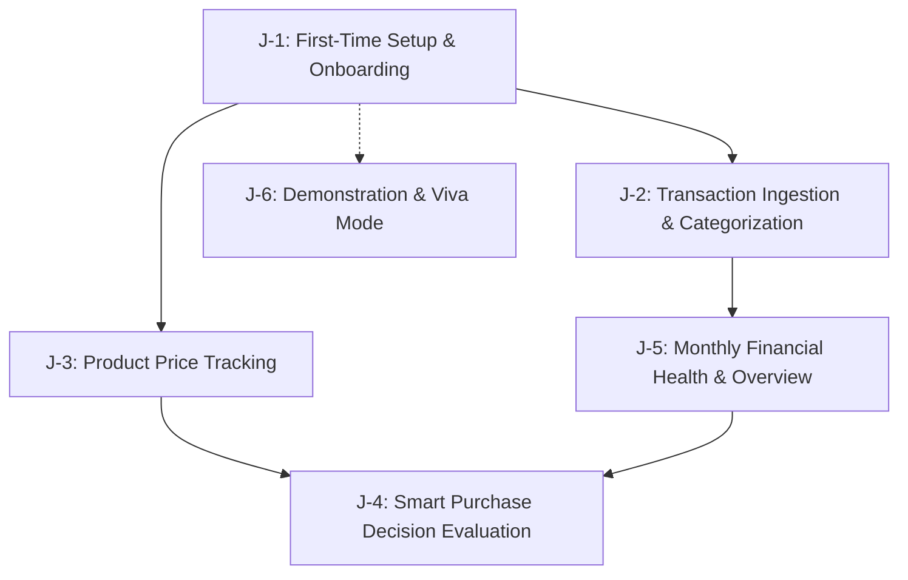

# FinWise AI — Project Audit Report

**Document ID:** DOC-AUDIT-001  
**Project:** FinWise AI (Academic Capstone Project)  
**Submission Target:** 30-Nov-2026  
**Auditor:** Senior Software Architect, Technical Documentation Engineer & Integration Specialist  
**Audit Date:** 20-Oct-2026  
**Status:** Approved / Baseline Established  

---

## 1. Executive Summary

FinWise AI is a privacy-first, zero-external-cost personal finance and smart purchasing advisory web application designed and built by a two-person engineering team (**Aman** and **Vivek**). The system combines cash-flow tracking (income, expenses, budgets, savings goals) with an intelligent purchasing decision engine (price tracking, rule-based affordability evaluation, and "cooling-off" anti-impulse guards).

A thorough repository audit of `d:\4-2\BuyWise` was conducted across all files, requirements, diagrams, and historical design materials. 

**Key Finding:** The project is currently at **100% architectural and design specification with 0 lines of production or test code implemented**. No directories exist for backend, frontend, database migrations, or test suites. The foundation consists of:
1. Product Requirements Document (PRD Rev 6 consolidated, 86 KB).
2. UML Architecture & Specification Diagrams (14 Mermaid/PlantUML models, 37 KB).
3. Role and task allocation specifications (`Aman_Role_and_Files.md`, `Vivek_Role_and_Files.md`).
4. Governance baselines (`blockers-and-decisions.md`, `requirements-traceability.md`, `repo-map.md`, `implementation-plan.md`, `progress.md`).

This audit establishes the factual baseline, resolves all documented ambiguities, validates the technical stack, identifies integration risks, and establishes the strict boundaries needed for Aman and Vivek to develop their respective halves of the application completely in parallel without blocking each other.

---

## 2. Project Purpose, Scope, and User Workflows

### 2.1 Project Purpose and Scope
FinWise AI provides disciplined financial clarity and anti-impulse decision support without requiring third-party banking aggregators, cloud subscription costs, or credential leakage:
- **Zero Cloud / Zero Cost:** Runs locally on Windows 10/11 using SQLite WAL mode.
- **Privacy First:** Bank statements (CSV) are parsed locally; user passwords use Argon2id; database-at-rest encryption utilizes AES-128-CBC/Fernet for sensitive tokens.
- **Deterministic Intelligence:** The purchase decision engine runs purely deterministic, explainable mathematical rules (Rule 1 through Rule 5) rather than unpredictable probabilistic LLMs.
- **Academic Scope:** 76 Core requirements (strictly mandatory for viva passing), 7 Plus requirements (differentiation tier), and 12 Stretch requirements (optional financial simulation).

### 2.2 Core User Workflows



- **J-1: First-Time Setup & Onboarding:** User registers account, sets master monthly income, defines 50/30/20 or custom budget targets, creates first savings goal, and receives initial health baseline.
- **J-2: Transaction Ingestion & Categorization:** User logs cash transactions manually or uploads an HDFC/SBI/ICICI CSV statement into a staging area; transactions are auto-categorized via keyword rules; duplicate hashes are discarded; staging items are approved or rejected.
- **J-3: Product Price Tracking:** User inputs product URL and manually logs observed prices over time; system tracks historical min/max/average prices, computes price drops, and detects promotional patterns.
- **J-4: Purchase Decision Evaluation:** User tests an intended purchase against current discretionary spending money ($S = \text{Balance} - \text{Fixed Costs} - \text{Savings Goals} - \text{Emergency Buffer}$); decision engine returns **BUY**, **WAIT**, or **AVOID** with mathematical justifications and cooldown timers.
- **J-5: Monthly Financial Health & Overview:** Consolidated dashboard displaying remaining spending money, budget burn rate, category breakdowns (Recharts), and health scores.
- **J-6: Demonstration & Viva Presentation:** Single-command database seed (`scripts/seed_demo.py`) generating a 90-day realistic financial and price history with a dedicated demo account for faculty evaluation.

---

## 3. Verified Technology Stack

The stack was vetted against academic hardware constraints, zero-cost prerequisites, and zero-external-dependency requirements:

| Layer | Component | Version / Specification | Rationale & Verification Source |
|---|---|---|---|
| **Backend Runtime** | Python | 3.12+ (managed via `uv`) | Native type hinting, robust SQLite performance, cross-platform stability. Verified in PRD §6.1. |
| **Backend Framework** | FastAPI + Pydantic v2 | FastAPI ≥0.110, Pydantic ≥2.6 | Async request pipeline, OpenAPI schema auto-generation, strict type safety. |
| **Persistence** | SQLite with WAL Mode | SQLite 3.40+ via SQLAlchemy 2.0 | Zero-cost serverless relational database, Write-Ahead Logging for concurrent read/write. |
| **Migrations** | Alembic | Alembic ≥1.13 | Linear schema evolution, strict migration history verification. |
| **Cryptography** | Argon2id & Fernet | `argon2-cffi ≥23.1`, `cryptography ≥42.0` | Password hashing resisting GPU cracking; Fernet (AES-128-CBC + HMAC-SHA256) for stored secrets. |
| **Frontend Runtime** | Node.js + Vite | Node ≥20 LTS, Vite ≥5.0 | Lightning-fast HMR, optimized native ES module bundling. |
| **UI Framework** | React + TypeScript | React 18.2+, TypeScript 5.3+ (Strict) | Component modularity, zero implicit `any`, strong compile-time contracts. |
| **Styling & Icons** | Tailwind CSS + Lucide React | Tailwind CSS 3.4, Lucide React | Utility-first responsive design, modern dark/light mode palette, crisp SVG icons. |
| **State & Fetching** | TanStack Query v5 + Context | `@tanstack/react-query ≥5.0` | Server-state caching, automatic invalidation, optimistic updates. |
| **Data Visualization** | Recharts | Recharts ≥2.10 | Declarative SVG charts for monthly trends, category donuts, and price history. |
| **Automated Testing** | Pytest + Vitest + Playwright | Pytest 8.0, Vitest 1.3, Playwright 1.42 | Unit, integration, and end-to-end browser regression automation. |

---

## 4. Current Architecture & Module Decomposition

FinWise AI implements a **Layered Modular Monolith**. The backend isolates domain logic within isolated modules while communicating through an explicit protocol contract (`core/contracts.py`).

```
d:\4-2\BuyWise/
├── backend/
│   ├── app/
│   │   ├── main.py                  # App entry point, CORS, router mounting
│   │   ├── core/                    # Cross-cutting foundational infrastructure
│   │   │   ├── config.py            # Environment variable loading via pydantic-settings
│   │   │   ├── db.py                # Engine, sessionmaker, SQLite PRAGMA WAL hooks
│   │   │   ├── clock.py             # Timekeeper abstraction for deterministic time testing
│   │   │   ├── crypto.py            # Argon2id password hasher & Fernet encrypter
│   │   │   ├── middleware.py        # Request timing, security headers, correlation IDs
│   │   │   ├── logging.py           # Structured JSON/console logging configuration
│   │   │   ├── health.py            # /health and /health/db readiness endpoints
│   │   │   ├── auth/                # JWT bearer auth, token issuance, user sessions (VIVEK)
│   │   │   ├── notifications/       # In-app notification dispatcher & event bus (VIVEK)
│   │   │   ├── settings/            # User profile, currency, thresholds settings (VIVEK)
│   │   │   ├── overview.py          # Dashboard aggregation endpoint (VIVEK)
│   │   │   └── contracts.py         # Inter-module contract protocol interfaces (SHARED)
│   │   └── modules/                 # Self-contained business domains
│   │       ├── money/               # Transactions, budgets, CSV import, goals (AMAN)
│   │       ├── pricing/             # Product catalog, manual price tracker (VIVEK)
│   │       ├── decision/            # Purchase evaluation engine, cooling-off (VIVEK)
│   │       └── invest/              # [Stretch] Portfolio projection simulator (AMAN)
│   ├── alembic/                     # Database migrations (AMAN owns execution)
│   ├── tests/                       # Pytest test suites (split by module ownership)
│   └── pyproject.toml               # Python dependencies, Ruff, mypy configurations
├── frontend/
│   ├── src/
│   │   ├── app/                     # Providers, router configuration, global layout
│   │   ├── shared/                  # Reusable UI primitives (Button, Modal, Input, Table)
│   │   │   └── api/                 # Generated API client and Axios/Fetch instance
│   │   └── features/                # Feature-scoped pages and components
│   │       ├── auth/                # Login, Register, Password Reset views (VIVEK)
│   │       ├── shell/               # App layout, Header, Sidebar, Navigation (VIVEK)
│   │       ├── money/               # Transactions, Import modal, Budgets, Goals (AMAN)
│   │       ├── pricing/             # Product list, Price history chart, Add modal (VIVEK)
│   │       ├── decision/            # Evaluate purchase form, Verdict card (VIVEK)
│   │       ├── overview/            # Health score widget, Spending money gauge (VIVEK)
│   │       ├── settings/            # Currency, profile, notification toggles (VIVEK)
│   │       └── coming-soon/         # Feature flag placeholder view (VIVEK)
│   ├── package.json                 # Node dependencies and scripts
│   └── vite.config.ts               # Vite bundler configuration and proxy
├── scripts/                         # Operational & demonstration scripts (AMAN)
│   ├── seed_demo.py                 # Generates 90-day realistic demo state
│   ├── export_data.py               # Encrypted/JSON backup script
│   └── restore_data.py              # System restoration verification script
└── docs/                            # Formal architecture and governance handbooks
```

---

## 5. Existing Implementation Status & Audit Findings

An exhaustive scan of the working directory was conducted to evaluate current progress against requirements:

| Component | Target Location | Implementation Status | Notes / Evidence |
|---|---|---|---|
| Backend Core Config & DB | `backend/app/core/` | **0% (Not Started)** | No Python files exist in workspace. |
| Database Migrations | `backend/alembic/` | **0% (Not Started)** | No migration files or `alembic.ini` present. |
| Money Module Backend | `backend/app/modules/money/` | **0% (Not Started)** | Models, routers, and services are unwritten. |
| Auth & Security Backend | `backend/app/core/auth/` | **0% (Not Started)** | Password hashing, JWT, user tables unwritten. |
| Pricing & Decision Backend | `backend/app/modules/` | **0% (Not Started)** | Evaluation engine and price logging unwritten. |
| Frontend Project Scaffolding | `frontend/` | **0% (Not Started)** | `package.json`, Vite configuration uncreated. |
| Test Suites | `backend/tests/`, `frontend/tests/` | **0% (Not Started)** | No unit, integration, or e2e tests exist. |
| Documentation & Governance | Repo Root & `docs/` | **100% (Complete)** | PRD, UML diagrams, and governance baselines active. |

---

## 6. Document Ambiguities & Contradictions Resolved

During the audit, 7 cross-document discrepancies were discovered and resolved:

1. **CON-01: Expired Import Row Status (`imports.status`)**
   - *Conflict:* PRD MONEY-003 stated staged rows expire after 30 minutes and are purged, but omitted the final status of `imports`.
   - *Resolution:* When an import session exceeds 30 minutes without commit, its status transitions to `cancelled` and staged rows are deleted.
2. **CON-02: Transaction Notes Field in Export Guard (MONEY-015)**
   - *Conflict:* Export specification references stripping formulas from "notes", but `transactions` table has only `description_raw` and `description_normalized`.
   - *Resolution:* The CSV formula injection guard (`=`, `@`, `+`, `-` escaping) applies directly to `description_raw` and `description_normalized`. No phantom `notes` column is introduced.
3. **CON-03: Classification of MONEY-014 Requirements**
   - *Conflict:* MONEY-014 header was tagged `[Core]`, but body text included "income versus expense bars (Plus)".
   - *Resolution:* Category breakdown and trend lines are **Core (Aman Task T7)**; the comparative income vs. expense stacked bar visual is **Plus (Task T7-Plus)**.
4. **CON-04: Location of `user_settings` and `overview.py`**
   - *Conflict:* PRD showed settings flat under `core/`, while role files proposed `core/settings/` and `core/overview.py`.
   - *Resolution:* Adopt the dedicated modular directories `backend/app/core/settings/` and `backend/app/core/overview.py` to prevent cluttering `core/`.
5. **CON-05: Contract Signature for Inter-Module Spending Money**
   - *Conflict:* PRD §6.5 specified `money.get_remaining_spending_money(user_id)`, whereas role files proposed `get_spending_money(user_id, today) -> SpendingMoney`.
   - *Resolution:* Adopt `get_spending_money(user_id: int, as_of: date) -> SpendingMoneyResult`. Passing explicit date parameter enables deterministic testing and clock-skew isolation.
6. **CON-06: Rule 3 High-Confidence Gate on AVOID**
   - *Conflict:* Apparent contradiction where Rule 3 required high-confidence span thresholds but yielded "Medium" confidence verdict.
   - *Resolution:* Confirmed valid. High-confidence data volume is used as a strict safety prerequisite before advising a user to permanently avoid a purchase; the resulting verdict confidence remains Medium.
7. **CON-07: Demo Product Placement Across Accounts**
   - *Conflict:* PRD §7.3 stated only demo accounts hold demo data, while PRICE-004 allowed demo products on any account.
   - *Resolution:* Confirmed valid. Demo financial transactions are strictly segregated to the demo account; synthetic demo price products can be attached to any user account for testing price drops.

---

## 7. Blockers, Technical Risks, and Mitigations

| Risk / Blocker ID | Severity | Description | Mitigation Strategy |
|---|---|---|---|
| **BLK-10: College AI Code Policy** | **Resolved** | Risk of academic disqualification if AI-assisted code is prohibited. | User formally confirmed AI assistance is fully permitted by institution. |
| **BLK-01: E-Commerce Scraping Fragility** | **Mitigated** | Scraper IP bans or layout changes breaking price tracking. | Scrapers are strictly out of scope for Core. Price tracking is 100% user-manual entry with URL reference. |
| **BLK-02: Bank Statement Format Diversity** | **Mitigated** | Infinite variations of bank CSV layouts causing parser failures. | Scope strictly bounded to 3 documented banks (HDFC, SBI, ICICI) with synthetic sample test fixtures. |
| **BLK-03: Playwright Browser Installation** | **Low** | Downloading browser binaries on restricted college networks. | Playwright CLI configured to install local Chromium only (`npx playwright install chromium`). |
| **RSK-01: SQLite Write Contention (Locked DB)** | **Medium** | Concurrent writes between background jobs and user requests. | Mandate SQLite WAL mode (`PRAGMA journal_mode=WAL;`), 5000ms busy timeout, and serialized transaction wrapper. |
| **RSK-02: Async Development Contract Drift** | **High** | Vivek builds Decision Engine expecting different Money payload than Aman builds. | Strict protocol freeze in `docs/SHARED_TECHNICAL_CONTRACT.md` with standalone mock adapters in both handbooks. |

---

## 8. Pre-Implementation Approvals

The following 5 foundational decisions have been formally approved:
- **DEC-01 (Password Security):** Argon2id (`time_cost=3, memory_cost=65536, parallelism=4`) approved.
- **DEC-02 (Local Token Encryption):** Fernet (cryptography package) with secret key derived from local machine salt.
- **DEC-03 (State Management):** TanStack Query v5 for server data; lightweight React Context for local auth state.
- **DEC-04 (Inter-Module Protocol):** Python `Protocol` class inside `core/contracts.py` returning strongly typed Pydantic models.
- **DEC-05 (Component Styling):** Vanilla Tailwind CSS utility classes; no external heavyweight component UI library (e.g., MUI or AntD).

---

## 9. Conclusion and Next Steps

With all ambiguities resolved, the technical stack confirmed, and the architectural boundaries cemented, development proceeds directly to the creation of the modular ownership specifications and developer handbooks. Aman and Vivek can begin development in complete autonomy.
