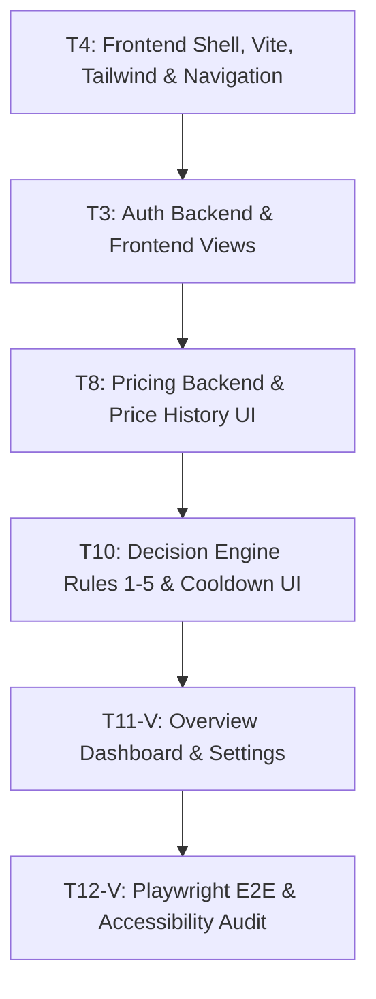

# FinWise AI — Vivek Development Handbook

**Document ID:** DOC-HB-VIVEK-005  
**Developer:** VIVEK  
**Role:** Authentication, Frontend Shell, Pricing & Purchase Decision Engine Lead  
**Contract Version Target:** 1.0.0 (`docs/SHARED_TECHNICAL_CONTRACT.md`)  
**Status:** Approved for Immediate Autonomous Execution  

---

## 1. Project Overview & Relevant Architecture

FinWise AI is a local, privacy-first personal finance and smart purchasing advisory web app designed for final-year engineering capstone evaluation.

As the user experience, intelligence, and purchasing advisory lead, you own the primary user-facing touchpoints and analytical intelligence of the application:
1. **Authentication & Identity:** User registration, Argon2id-backed login, JWT token issuance, session lifecycle, and authentication guards.
2. **Frontend Shell & Design System:** Vite + React + Tailwind CSS foundation, responsive sidebar and header, navigation routing, and reusable UI primitives.
3. **Price Tracking Subsystem:** Product registry, manual price observation logger, historical price charts, and price drop detection.
4. **Smart Purchase Decision Engine:** The signature intellectual property of FinWise AI — deterministic, explainable mathematical evaluation (Rules 1 through 5) delivering **BUY**, **WAIT**, or **AVOID** recommendations and enforced cooling-off periods.
5. **Overview Dashboard & Settings:** Top-level financial health overview and user preference management.

You will develop, test, and verify your entire subsystem in complete isolation without waiting for Aman's Money module or database migrations to be completed.

---

## 2. Vivek's Responsibilities & Ownership Boundaries

### What You Own:
- `backend/app/core/auth/**` (Models, schemas, services, routes, JWT dependencies)
- `backend/app/core/notifications/**` (In-app notifications system)
- `backend/app/core/settings/**` (User profile & preferences)
- `backend/app/core/overview.py` (Dashboard aggregation endpoint)
- `backend/app/modules/pricing/**` (Product catalog & price observation history)
- `backend/app/modules/decision/**` (Rules 1 to 5 decision engine & cooling-off periods)
- `backend/tests/test_auth_*.py`, `backend/tests/test_pricing_*.py`, `backend/tests/test_decision_*.py`
- `frontend/src/app/**` (Providers, Router, Layout)
- `frontend/src/shared/ui/**` (Reusable primitives: Button, Modal, Input, Badge, Table)
- `frontend/src/features/auth/**`, `shell/**`, `pricing/**`, `decision/**`, `overview/**`, `settings/**`, `coming-soon/**`
- `frontend/package.json` (Frontend dependency manifest)

---

## 3. Requirements Assigned to Vivek

All requirements are traced directly to PRD Revision 6:

| Req ID | Title | Priority | Target File / Service |
|---|---|---|---|
| **AUTH-001..008** | Registration, Login, JWT, Password Rules, Demo Mode | Core | `core/auth/`, `frontend/src/features/auth/` |
| **SHELL-001** | Responsive Navigation, Sidebar & Header | Core | `frontend/src/features/shell/` |
| **SHELL-002** | Dark/Light Mode Theme Toggle | Plus | `frontend/src/features/shell/ThemeToggle.tsx` |
| **NOTIF-001** | In-App Notifications for Cooldown Expiry | Core | `core/notifications/` |
| **PRICE-001** | Product Registry (Title, URL, Category) | Core | `modules/pricing/services/product_service.py` |
| **PRICE-002** | Manual Price Observation Logging | Core | `modules/pricing/services/price_service.py` |
| **PRICE-003** | Price History Analytics (Min, Max, Avg, Volatility) | Core | `modules/pricing/services/price_service.py` |
| **PRICE-004** | Demo Products & Pre-Loaded Drops | Core | `modules/pricing/routers/products.py` |
| **PRICE-005** | Historical Price Trend Chart (Recharts) | Core | `frontend/src/features/pricing/PriceChart.tsx` |
| **DECIDE-001** | Purchase Evaluation Form & Intent Input | Core | `frontend/src/features/decision/EvaluateForm.tsx` |
| **DECIDE-002** | Rule 1: Discretionary Spending Affordability | Core | `modules/decision/services/rules/rule1_affordability.py` |
| **DECIDE-003** | Rule 2: Budget Category Burn Rate | Core | `modules/decision/services/rules/rule2_burn_rate.py` |
| **DECIDE-004** | Rule 3: Price History & Promotion Timing | Core | `modules/decision/services/rules/rule3_price_history.py` |
| **DECIDE-005** | Rule 4: Priority Rating vs. Velocity | Core | `modules/decision/services/rules/rule4_priority.py` |
| **DECIDE-006** | Rule 5: Savings Goal Impact Evaluation | Core | `modules/decision/services/rules/rule5_goal_impact.py` |
| **DECIDE-007** | Verdict Generation (BUY / WAIT / AVOID) | Core | `modules/decision/services/engine.py` |
| **DECIDE-008** | Cooling-Off Period Calculation & Storage | Core | `modules/decision/services/cooldown_service.py` |
| **DECIDE-009** | Cooldown Timer UI & Expiry State | Core | `frontend/src/features/decision/CooldownTimer.tsx` |
| **DECIDE-010** | Override Purchase Warning Logging | Core | `modules/decision/services/decision_service.py` |
| **OVR-001..003** | Overview Dashboard KPIs, Spending Gauge, Health Score | Core | `core/overview.py`, `features/overview/` |
| **SET-001..005** | User Profile, Currency Selector, Emergency Thresholds | Core | `core/settings/`, `features/settings/` |

---

## 4. Explicit Exclusions: What Vivek Must NOT Do

1. **Do NOT write Money module code:** Aman owns `backend/app/modules/money/` and `frontend/src/features/money/`.
2. **Do NOT query Money database tables directly:** Never run queries on `transactions`, `budgets`, or `savings_goals`. You must consume the inter-module contract `MoneyModuleProtocol` via `MockMoneyService` (see §12).
3. **Do NOT edit Alembic migrations:** Aman is the sole owner of `backend/alembic/`.
4. **Do NOT alter core database engine or crypto pragmas:** Aman maintains `backend/app/core/db.py` and `crypto.py`.

---

## 5. Source Documentation to Read First

Before writing any code, thoroughly review:
1. `docs/PROJECT_AUDIT_REPORT.md` (System overview, technology stack).
2. `docs/ARCHITECTURE_AND_MODULE_OWNERSHIP.md` (Module boundaries, RFC process).
3. `docs/SHARED_TECHNICAL_CONTRACT.md` (§2 Auth payload, §3 Protocol & Mock, §4 REST endpoints).
4. `FinWise AI — Product Requirements Document.md` (§4.1 Auth, §4.3 Pricing, §4.4 Decision Engine).
5. `FinWise_AI_UML_Diagrams.md` (Decision Engine sequence diagrams).

---

## 6. Files Vivek May Create or Modify

```
backend/
└── app/
    ├── core/
    │   ├── auth/
    │   │   ├── models.py
    │   │   ├── schemas.py
    │   │   ├── services.py
    │   │   ├── dependencies.py
    │   │   └── router.py
    │   ├── notifications/
    │   ├── settings/
    │   └── overview.py
    └── modules/
        ├── pricing/
        │   ├── models.py
        │   ├── schemas.py
        │   ├── services.py
        │   └── router.py
        └── decision/
            ├── models.py
            ├── schemas.py
            ├── services/
            │   ├── engine.py
            │   ├── rules/
            │   └── cooldown_service.py
            └── router.py
tests/
├── test_auth_*.py
├── test_pricing_*.py
└── test_decision_*.py
frontend/
├── package.json
├── vite.config.ts
├── tailwind.config.js
└── src/
    ├── app/
    ├── shared/ui/
    └── features/
        ├── auth/
        ├── shell/
        ├── pricing/
        ├── decision/
        ├── overview/
        ├── settings/
        └── coming-soon/
```

---

## 7. Files Vivek Must NOT Modify

- `backend/app/modules/money/**` (Aman)
- `backend/app/modules/invest/**` (Aman)
- `backend/alembic/**` (Aman)
- `backend/app/core/db.py`, `clock.py`, `crypto.py`, `middleware.py`, `health.py` (Aman)
- `frontend/src/features/money/**` (Aman)
- `scripts/**` (Aman)

---

## 8. Implementation Sequence & Task Schedule



---

## 9. Detailed Technical Instructions by Task

### Task T4: Frontend Shell, Vite, Tailwind & Layout
- **Objective:** Scaffold the React 18 + Vite application in `frontend/`, configure Tailwind CSS, Lucide React, and build responsive AppShell (Header, Sidebar, Navigation).
- **Execution:**
  ```powershell
  cd frontend
  npm install
  npm install @tanstack/react-query react-router-dom lucide-react recharts clsx tailwind-merge
  ```
- **Deliverables:**
  - `src/app/App.tsx`: Root providers (QueryClientProvider, AuthProvider, BrowserRouter).
  - `src/features/shell/AppLayout.tsx`: Responsive navigation grid with desktop sidebar and mobile bottom-bar.
  - `src/shared/ui/`: Atomic primitives (`Button.tsx`, `Modal.tsx`, `Input.tsx`, `Badge.tsx`, `Card.tsx`).
  - Feature placeholder in routes for Aman: `<Route path="/money/*" element={<MoneyFeaturePlaceholder />} />`.

### Task T3: Authentication Subsystem (Backend & Frontend)
- **Objective:** Implement user registration, Argon2id verification, JWT issuance, route guards, and frontend screens.
- **Backend Details:**
  - Password rules: Min 8 chars, 1 uppercase, 1 lowercase, 1 number, 1 symbol.
  - Endpoints: `POST /api/v1/auth/register`, `POST /api/v1/auth/login`.
  - Dependency: Provide `get_current_user` reading Bearer token and returning `AuthenticatedUser`.
- **Frontend Views:** `features/auth/LoginView.tsx`, `features/auth/RegisterView.tsx`.

### Task T8: Pricing Subsystem (Backend & UI)
- **Objective:** Build product registry, manual price observation tracking, price statistics, and Recharts history visual.
- **Mathematical Metrics:**
  - $P_{\min} = \min(P_1, P_2, \dots, P_n)$
  - $P_{\max} = \max(P_1, P_2, \dots, P_n)$
  - $P_{\text{avg}} = \frac{1}{n} \sum P_i$
  - Volatility Index $= \frac{\sigma}{\bar{P}} \times 100$
- **Frontend:** `features/pricing/PriceHistoryChart.tsx` displaying date vs. price with min/max reference lines.

### Task T10: Smart Purchase Decision Engine & Cooling-Off Period
- **Objective:** The signature intelligence module. Implement Rules 1 through 5, verdict calculation, and cooling-off timers.
- **Deterministic Rules Architecture:**
  1. **Rule 1 (Affordability):** Compare price against `discretionary_spending_money`. If price $> 100\%$ of spending money $\rightarrow$ `AVOID`. If $> 50\% \rightarrow$ `WAIT`.
  2. **Rule 2 (Category Burn Rate):** Check spending velocity of target category. If velocity exceeds safe monthly pace $\rightarrow$ `WAIT`.
  3. **Rule 3 (Historical Price Timing):** If current price $> P_{\text{avg}}$ and historical drop predicted $\rightarrow$ `WAIT`. If span $\ge 30$ days and at historical high $\rightarrow$ `AVOID` (Confidence: Medium).
  4. **Rule 4 (Priority vs Velocity):** If priority is low (1 or 2 out of 5) and discretionary velocity $< 0 \rightarrow$ `AVOID`.
  5. **Rule 5 (Savings Goal Impact):** Evaluate delay caused to active savings goals. If purchase delays goal $> 30$ days $\rightarrow$ `WAIT`.
- **Cooling-Off Hours Formula:**
  $$\text{Cooldown Hours} = \min\left(168, \max\left(24, \frac{\text{Price}}{\text{Discretionary Spending}} \times 48\right)\right)$$
- **UI:** Render prominent Verdict Banner (Green = BUY, Amber = WAIT, Red = AVOID) with mathematical rationale bullets and a real-time countdown timer for active cooldowns.

### Task T11-V: Overview Dashboard & Settings
- **Objective:** Build `/api/v1/overview` endpoint and dashboard view aggregating financial KPIs, spending gauge, health score, and active cooldown cards.

---

## 10. Exact Interfaces & Contracts to Follow

- You must consume `MoneyModuleProtocol` exactly as defined in `docs/SHARED_TECHNICAL_CONTRACT.md` §3.
- Your Auth endpoints and JWT structure must conform strictly to `docs/SHARED_TECHNICAL_CONTRACT.md` §2.
- Error responses must follow the standard envelope schema (`docs/SHARED_TECHNICAL_CONTRACT.md` §4.1).

---

## 11. Local Setup & Independent Execution Instructions

```powershell
# 1. Checkout Vivek branch
git checkout -b feature/vivek-shell-decision

# 2. Setup backend environment
cd backend
uv sync
cp .env.example .env

# 3. Run backend with in-memory SQLite (for independent testing)
uv run uvicorn app.main:app --reload --port 8000

# 4. Setup frontend in separate terminal
cd ../frontend
npm install
npm run dev
# Browser opens at http://localhost:5173
```

---

## 12. Mocking Instructions for Aman's Money Module

When developing the Decision Engine and Overview Dashboard, use the standalone `MockMoneyService` in your tests and local dev injection:

```python
# backend/app/modules/decision/services/engine.py
from app.core.contracts import MoneyModuleProtocol, SpendingMoneyResult, SpendingRuleApplied

class MockMoneyService:
    def get_spending_money(self, user_id: int, as_of):
        return SpendingMoneyResult(
            user_id=user_id,
            as_of_date=as_of,
            available_balance=50000.0,
            fixed_costs_reserved=20000.0,
            savings_goals_reserved=10000.0,
            emergency_buffer_reserved=5000.0,
            discretionary_spending_money=15000.0,  # Fixed INR 15,000 for mock tests
            rule_applied=SpendingRuleApplied.BUDGET_REMAINING,
            days_remaining_in_month=15,
            daily_budget_velocity=1000.0
        )
```

In your unit tests, inject `MockMoneyService(discretionary_override=...)` to test BUY, WAIT, and AVOID scenarios deterministically.

---

## 13. Required Unit, Integration & Browser Tests

You are required to achieve **>85% code coverage** on your owned modules:
1. `test_auth.py`: Registration, Argon2id verification, invalid password rejection, JWT issuance, and expired token rejection.
2. `test_pricing.py`: Product creation, duplicate URL handling, min/max/average recalculations upon new price log.
3. `test_decision_rules.py`:
   - Test Rule 1: Price 20,000 against 15,000 spending money $\rightarrow$ `AVOID`.
   - Test Rule 1: Price 8,000 against 15,000 spending money $\rightarrow$ `WAIT`.
   - Test Rule 1: Price 2,000 against 15,000 spending money $\rightarrow$ `BUY`.
   - Test Cooling-Off period calculation bounds (between 24h and 168h).
4. `test_frontend_shell.vitest.ts`: Vitest component tests verifying theme toggle, header rendering, and navigation route clicks.
5. `e2e/decision_flow.spec.ts`: Playwright test logging in, opening Evaluate Purchase form, submitting product, and verifying the WAIT verdict banner and timer.

---

## 14. Quality Standards & Definition of Done

A task is marked **DONE** only when:
- [ ] 100% type hints pass `uv run mypy --strict app`.
- [ ] Frontend passes TypeScript compile (`npm run build` with zero errors).
- [ ] Zero lint violations in `ruff` and `eslint`.
- [ ] All unit, integration, and Playwright tests pass cleanly.
- [ ] No files outside Vivek's ownership were modified.

---

## 15. Git Workflow & Isolation Rules

- Work exclusively on `feature/vivek-shell-decision`.
- Commit with conventional commit messages: `feat(decision): ...`, `feat(auth): ...`.
- Never commit to `main` directly.
- Submit a PR targeting `integration/parallel-development`.
